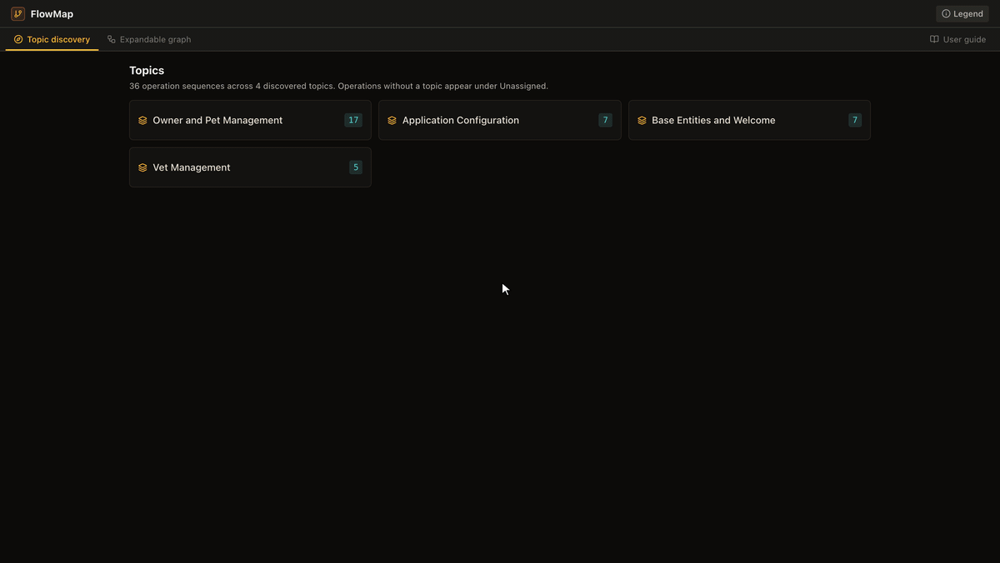
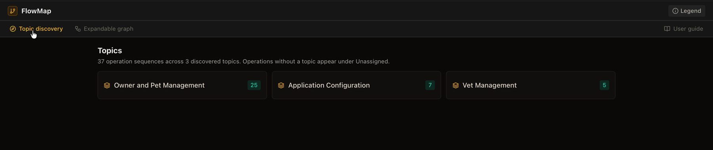
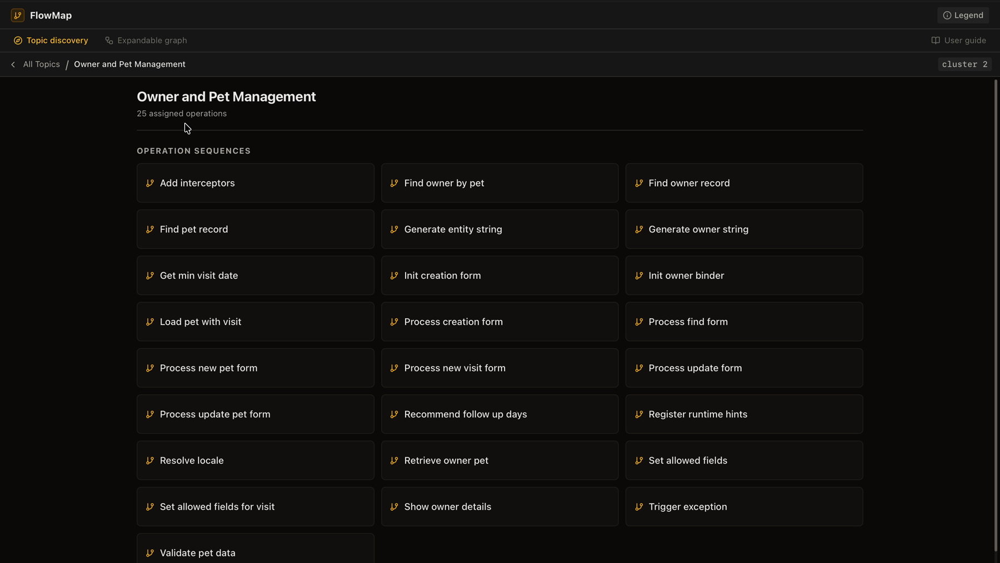
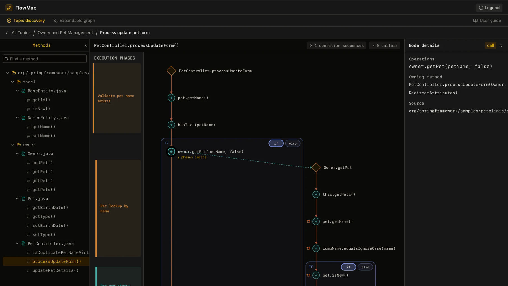
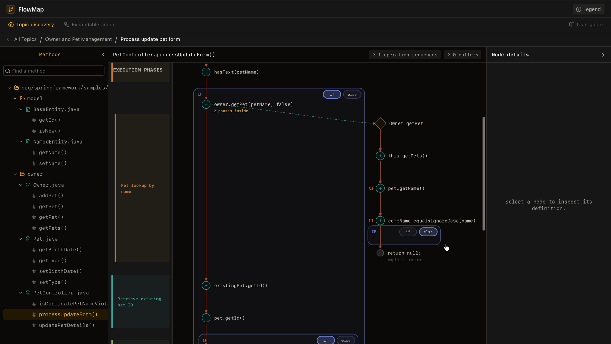
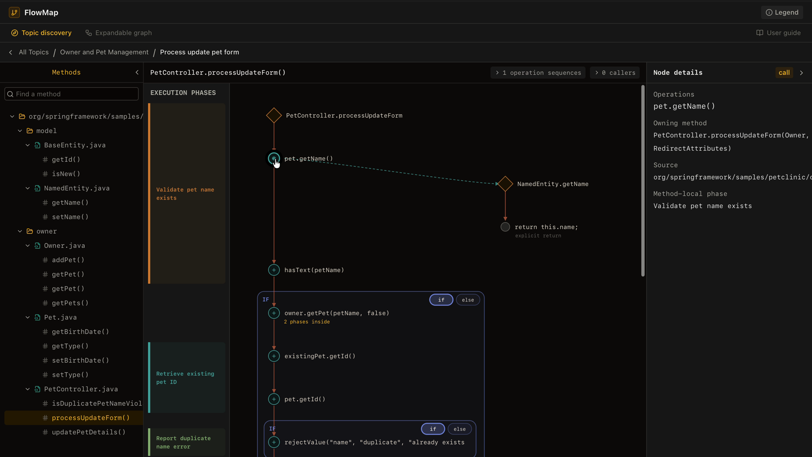

# FlowMap

**Understand an unfamiliar Java codebase by the business operations it performs, not by its file tree.**

FlowMap statically analyses a Java project and turns it into an interactive map: related code is grouped into *topics* (e.g. "Owner and Pet Management"), each topic lists the *operations* it supports (e.g. "Process new visit form"), and each operation opens as a control-flow graph split into labelled *execution phases* ("Validate visit date", "Reject invalid input"). You can expand any call to step into the method it invokes.

It was built as my MSc thesis project at Imperial College London.



*FlowMap running on [Spring PetClinic](https://github.com/spring-projects/spring-petclinic). More screenshots are under [Using the viewer](#using-the-viewer).*

## How it works

```
Java source ──► Joern CPG ──► CFG + targeted data-flow ──► noise filtering & entry-point detection
                                                                     │
        ┌────────────────────────────────────────────────────────────┤
        ▼                                ▼                           ▼
 Topic discovery                 Execution-phase analysis     Operation sequences
 (sentence embeddings, UMAP,     (structural segmentation,    (one per entry point,
  HDBSCAN, LLM labels)            LLM merge/split + labels)    assigned to topics)
        └────────────────────────────────┬───────────────────────────┘
                                         ▼
                         JSON artifacts ──► React viewer
```

1. **Code property graph.** [Joern](https://joern.io) parses the project into a CPG. FlowMap queries it for class/method documents and the intra- and inter-procedural control-flow graph, then pulls data-dependency edges only for the node pairs it needs.
2. **Filtering.** Joern-synthetic operators and JDK library plumbing are stripped, and the remaining methods are classified into operation entry points (roots) and helpers.
3. **Topic discovery.** Class and README documents are embedded with `sentence-transformers`, reduced with UMAP, clustered with HDBSCAN and named by an LLM. Degenerate clusterings fall back to whole-corpus LLM grouping.
4. **Execution phases.** Each method is segmented into phases from its control-flow structure and data flow. Where the structure is ambiguous, an LLM decides whether adjacent steps belong together, then labels each phase.
5. **Viewer.** A React + TypeScript app renders topics, operations and an expandable, phase-annotated graph with branch selection, loop markers and method source details.

LLM calls are batched, rate-limit aware, retried, and validated against a schema. Everything else is deterministic for a fixed seed.

## Quick start

### Prerequisites

| Tool | Version | Install |
| --- | --- | --- |
| Python | 3.12+ | [python.org](https://www.python.org/downloads/) |
| Poetry | 2.x | `pipx install poetry` |
| Java (JDK) | 17+ | `brew install openjdk` |
| Joern | latest | [docs.joern.io/installation](https://docs.joern.io/installation) |
| Node.js | 20.19+ | [nodejs.org](https://nodejs.org) |

You also need an API key for an LLM provider: [Groq](https://console.groq.com/keys) (default, has a free tier) or [Together AI](https://api.together.ai).

### Setup

```bash
git clone https://github.com/cindracindra/flowmap.git
cd flowmap
cp .env.example .env    # then add your GROQ_API_KEY
```

### Run

One command analyses a project and opens the viewer in your browser:

```bash
./flowmap.sh path/to/java-project
```

For example, with Spring PetClinic:

```bash
git clone https://github.com/spring-projects/spring-petclinic.git ../spring-petclinic
./flowmap.sh ../spring-petclinic
```

The first run installs the Python and frontend dependencies. Results are saved to `runs/<project-name>/`, so running the same command again skips the analysis and opens the viewer straight away.

| Option | Description |
| --- | --- |
| `-o, --output DIR` | Where results are stored (default: `runs/<project-name>`) |
| `-p, --provider NAME` | `groq` (default) or `together` |
| `--preset NAME` | Topic granularity: `fine`, `balanced` (default) or `coarse` |
| `--reanalyse` | Discard saved results and analyse again |
| `--analyse-only` | Run the analysis without starting the viewer |
| `--view-only` | Open existing results without re-analysing |
| `--port N` | Viewer port (default: 5173) |

> **Note:** Groq's free tier has a low tokens-per-minute limit. FlowMap retries automatically, so a medium-sized project can take several minutes. Rate-limit messages in the log are expected.

## Using the viewer

**1. Pick a topic.** FlowMap groups the codebase into topics and counts the operations in each.



**2. Pick an operation.** Each topic lists its operations, each named by the LLM from what the code does.



**3. Read the phased graph and expand calls.** The operation opens as a control-flow graph. The coloured bands on the left are *execution phases* that summarise each stretch of code. Click a `+` node to expand the method it calls inline. The callee's own phases slot in between the caller's, and the rest of the caller moves down to make room.



| **Switch branches** | **Inspect a node** |
| --- | --- |
| `if`/`else`, `try`/`catch` and polymorphic dispatch arms can be toggled to follow one path at a time. | Select any node to see its code, owning method, source file and phase. |
|  |  |

The **Expandable graph** tab lets you start from any method instead of a topic. The in-app **User guide** (top right) explains every panel and node type.

## Project structure

```
flowmap.sh                 One-command launcher (analyse + view)
backend/src/flowmap/
  main.py                  Pipeline entry point
  joern/                   Joern server session and CPG queries (.sc scripts)
  service/                 Pipeline stages that talk to Joern or the LLM
  domain/                  Pure analysis logic: CFG filtering and slicing,
                           topic discovery, execution phases, operation sequences
  model/                   Graph and document data types
  llm/                     Provider client, batching policy, prompts, parsing
  presentation/            Serialisation into the viewer's graph bundle
  telemetry/               Optional run telemetry (--eval-output)
frontend/
  src/views/               Topic discovery, expandable graph, user guide
  src/lib/                 Graph projection, layout and loop detection
  tests/                   Layout/projection checks (npm test)
test/
  unit/                    Unit tests (no external tools needed)
  integration/             Tests that run Joern on test/fixtures
```

## Development

```bash
poetry install
poetry run pytest test/unit           # unit tests
poetry run pytest test/integration    # needs Joern installed

cd frontend
npm install
npm test                              # graph layout/projection checks
npm run build                         # type-check and production build
```

The pipeline can also be run directly, for example to record telemetry:

```bash
poetry run python backend/src/flowmap/main.py --source-dir path/to/project --output-dir runs/my-run --eval-output
```

Run `poetry run python backend/src/flowmap/main.py --help` for all options.

## Tech stack

- **Analysis:** Python, Joern (Scala CPG queries), scikit-learn, UMAP, HDBSCAN, sentence-transformers, Groq / Together AI LLM APIs
- **Viewer:** React 19, TypeScript, Vite, Radix UI
